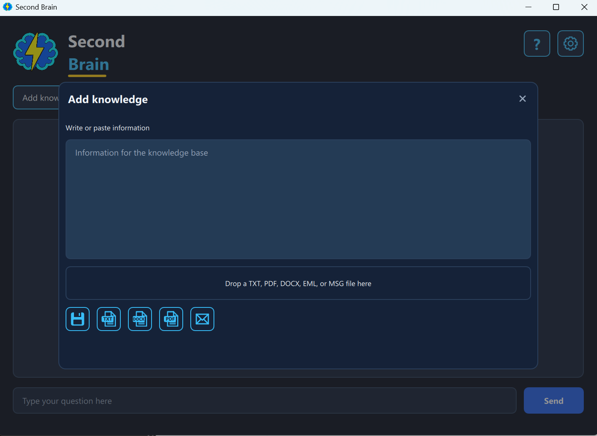
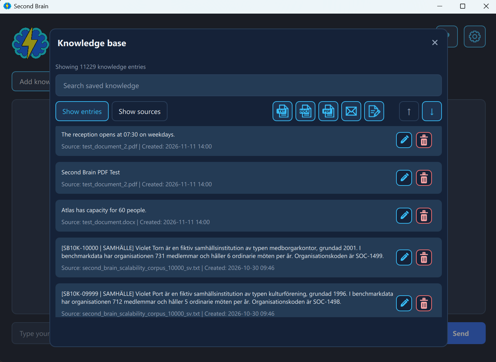

# Adding Knowledge

Second Brain can store information in several different ways.

You can add knowledge manually or import supported files such as TXT, DOCX, PDF, EML and MSG.

## Open the knowledge dialog

Select **Add knowledge** from the toolbar.

  

From this dialog you can:

- enter information manually
- import a TXT file
- import a DOCX document
- import a PDF document
- import an EML or MSG email
- drag and drop supported files into the application

## Add knowledge manually

Enter the information you want to store in the text field and select **Save knowledge**.

Second Brain creates an embedding for the text and stores the entry in the local knowledge base.

If the same information already exists, Second Brain will not create a duplicate entry.

## Import documents

Supported document types include:

- TXT
- DOCX
- PDF

When importing supported documents, Second Brain extracts text from the file before it is stored.

Some document workflows also allow you to review the extracted text or use AI to suggest useful factual passages before saving them.

## Import email

Second Brain supports:

- EML
- MSG

Imported email can be previewed before it is stored.

You can either save the complete email or use AI analysis to suggest useful facts for manual review.

## Drag and drop

Supported files can also be dragged directly into the knowledge dialog.

Second Brain detects the file type and opens the appropriate import or review flow.

## View saved knowledge

Select **View knowledge entries** from the toolbar to inspect the contents of the knowledge base.

  

The knowledge view allows you to:

- search stored information
- filter by file type
- sort entries by date
- switch between individual entries and sources
- edit saved knowledge
- delete entries
- delete all entries associated with a source

## Next steps

After adding knowledge, continue with [Asking Questions](asking-questions.md) to learn how Second Brain retrieves and uses stored information.