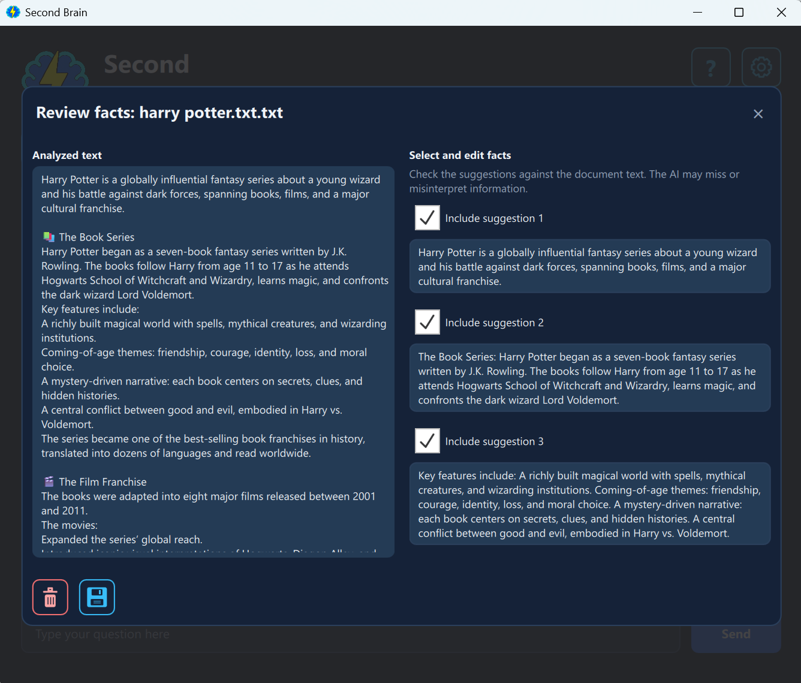

# AI Analysis

Second Brain can use the selected local language model to suggest useful factual information from imported documents and emails.

The purpose of AI analysis is to help identify information that may be worth saving without automatically adding unreviewed AI output to the knowledge base.

!!! warning
    Always review AI-generated suggestions before saving them. The model may miss, omit or misinterpret information.

## How AI analysis works

When you analyze a supported document or email, Second Brain:

1. reads the text currently shown in the preview
2. sends the text to the selected local language model
3. asks the model to identify useful factual passages
4. presents the suggestions for manual review
5. lets you decide what should be saved

Nothing is saved automatically during the analysis.

## Analyze a document

After importing a supported document, review the extracted text in the preview.

You can then choose to let Second Brain suggest useful facts with AI.

The analysis may take some time depending on:

- the length of the document
- the selected language model
- your computer's hardware

When the analysis is complete, the suggested passages are shown in a review dialog.

## Analyze an email

Imported EML and MSG files can also be analyzed.

You can either:

- save the complete email
- analyze the email and review suggested facts

AI analysis is useful when an email contains a mixture of important information and less relevant content such as greetings, introductions or general commentary.

## Review suggested facts

The review dialog shows:

- the original text
- the AI-generated suggestions
- controls for selecting which suggestions to keep

Before saving, you can:

- include or exclude individual suggestions
- edit the suggested text
- compare suggestions with the original source
- discard the suggestions entirely

You should always review the suggestions before saving them.

  

## Why manual review matters

Language models can:

- miss useful information
- include irrelevant information
- misunderstand context
- omit important details
- interpret text incorrectly

For this reason, Second Brain treats AI output as suggestions rather than verified knowledge.

The user remains responsible for deciding what is stored in the knowledge base.

## Saving reviewed facts

After reviewing the suggestions, select the facts you want to keep and save them.

Each saved fact becomes a separate knowledge entry associated with the original source.

Exact duplicates are skipped.

## Discarding suggestions

If the suggestions are not useful, you can discard the review without saving anything.

The original source remains unchanged.

## Local processing

AI analysis uses the currently selected local language model.

The analysis therefore depends on the capabilities of the model currently loaded in Second Brain.

## Next steps

Continue with [Settings](settings.md) to learn how to change the language model, interface language and RAG configuration.