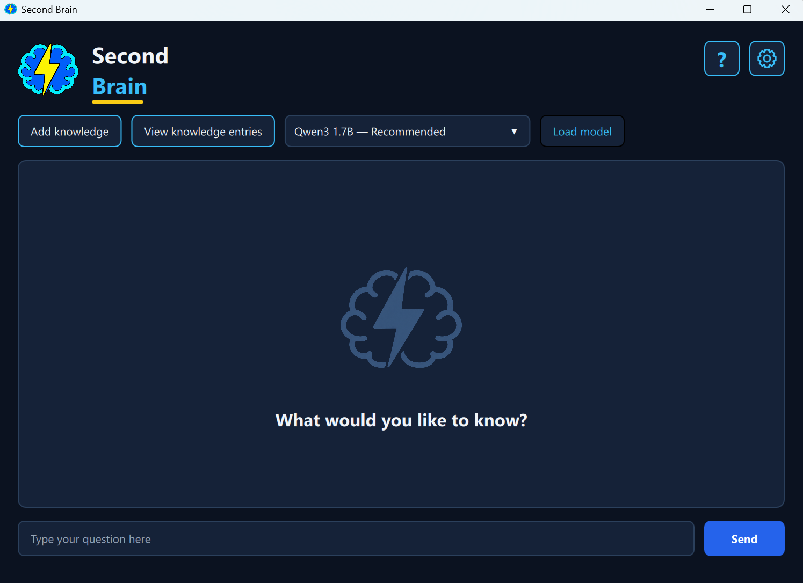

# Second Brain

Second Brain is a local desktop application for storing, organizing and retrieving personal knowledge with the help of AI.

The application allows you to import information from documents and emails, review AI-generated factual suggestions, and ask questions based on the knowledge stored in your local database.

  

## What can Second Brain do?

With Second Brain you can:

- add knowledge manually
- import TXT, DOCX and PDF documents
- import EML and MSG email files
- review and edit imported information
- let AI suggest useful facts from documents and emails
- ask questions based on your saved knowledge
- inspect the sources used for an answer
- search, edit and delete stored knowledge
- switch between Swedish and English
- change the local language model and RAG settings
- export and restore database backups

## Getting started

If this is your first time using Second Brain, start with the [Getting Started](getting-started.md) guide.

You can then continue with:

- [Adding Knowledge](adding-knowledge.md)
- [Asking Questions](asking-questions.md)
- [Managing Knowledge](managing-knowledge.md)
- [AI Analysis](ai-analysis.md)
- [Settings](settings.md)
- [Backup](backup.md)

## Local and private

Second Brain is designed as a local desktop application. Knowledge is stored locally and the application uses locally loaded language models for its AI features.