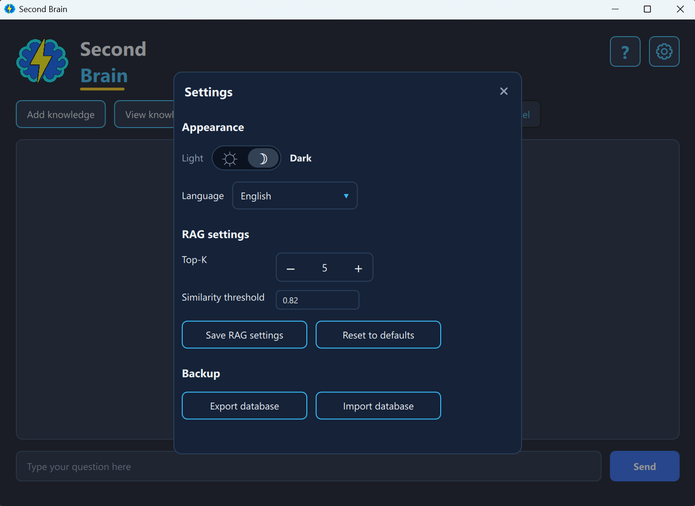

# Settings

The Settings dialog contains configuration options for the Second Brain interface, retrieval behavior and backups.

## Open Settings

Open **Settings** from the application header.

Changes to interface language and appearance are applied immediately.

<p align="center">
  
</p>

## Language

Second Brain currently supports:

- Swedish
- English

The selected language is saved and restored the next time the application starts.

Changing the interface language updates the available user interface text throughout the application.

## Appearance

Second Brain supports both:

- Light mode
- Dark mode

Use the appearance setting to switch between the available themes.

## Language model

The toolbar allows you to select between different local language models.

Available options include:

- Qwen3 0.6B — faster and less demanding
- Qwen3 1.7B — recommended default
- Qwen3 4B — slower and more demanding

Loading a new model may take some time depending on:

- model size
- available hardware
- whether the model is already available locally

The currently loaded model is used for question answering and AI-assisted document or email analysis.

## RAG settings

Second Brain uses retrieval-augmented generation to find relevant information before generating an answer.

Two retrieval settings can be adjusted.

!!! note
    The default RAG settings are a good starting point for normal use. Change them only if you want to experiment with retrieval behavior.

### Top-K

**Top-K** controls how many potentially relevant knowledge entries are retrieved.

A higher value allows more entries to be considered, while a lower value limits the amount of retrieved information.

The default value is:

```text
5
```

### Similarity threshold

The **Similarity threshold** controls how closely a knowledge entry must match the question before it is considered relevant.

The default value is:

```text
0.82
```

Higher values require a closer semantic match.

Lower values allow more loosely related entries to be considered.

## Reset RAG settings

Use **Reset to defaults** to restore the standard retrieval configuration.

The default settings are intended to provide a useful balance for normal use.

## Backup

The Settings dialog also contains controls for exporting and importing the knowledge database.

You can:

- export the database to a JSON backup file
- restore knowledge from a previously exported backup

For more information, see [Backup](backup.md).

## Recommended settings

For normal use, the default configuration is a good starting point:

- Qwen3 1.7B
- Top-K: 5
- Similarity threshold: 0.82

You can adjust these values later if you want to experiment with retrieval quality or performance.