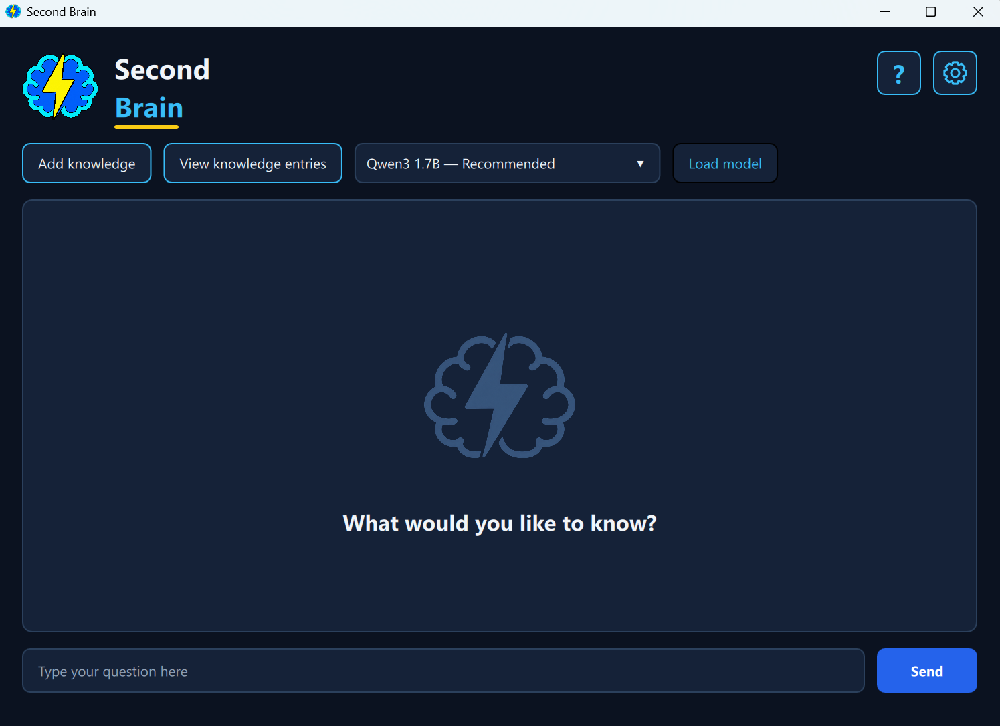

# 🧠 Second Brain

Second Brain is a local desktop knowledge-base application that uses retrieval-augmented generation (RAG) and local language models to help users store, review and retrieve information through natural-language questions.

The project was developed as part of a LIA internship project and is built around local knowledge storage, semantic retrieval and local AI.

<br><br>
<p align="center">
  
</p>
<br><br>

## 📖 User Manual

A complete user manual is available online:

### [**Open the Second Brain User Manual →**](https://xuenjing.github.io/Second-Brain/)

The manual covers getting started, importing knowledge, asking questions, AI-assisted analysis, knowledge management, settings and backup.

---

## ✨ Features

- Local knowledge storage with SQLite
- Natural-language questions using retrieval-augmented generation
- Hybrid semantic and lexical retrieval
- Source references for generated answers
- Manual knowledge entry
- TXT, DOCX and PDF import
- EML and MSG email import
- AI-assisted fact extraction from documents and emails
- Review and editing of AI suggestions before saving
- Search, filtering and sorting of stored knowledge
- Editing and deletion of stored knowledge
- Source-based knowledge management
- Selectable local language models
- Configurable Top-K and similarity threshold
- Swedish and English interface
- Light and dark appearance
- JSON backup and restore
- Background language-model generation to keep the interface responsive

---

## ⚙️ How It Works

Second Brain uses a retrieval-augmented generation pipeline:

```text
User question
      ↓
Knowledge retrieval
      ↓
Relevant stored information
      ↓
Local language model
      ↓
Generated answer + sources
```

Stored knowledge is converted into embeddings. When the user asks a question, Second Brain retrieves relevant information and provides it as context to the selected language model.

The answer is then returned together with its source references, allowing the user to inspect the knowledge used to generate it.

---

## 📁 Supported File Formats

| Format | Support                               |
| ------ | ------------------------------------- |
| TXT    | Text import                           |
| DOCX   | Text and table extraction             |
| PDF    | Text-based PDF extraction             |
| EML    | Email preview and AI analysis         |
| MSG    | Outlook email preview and AI analysis |

Scanned or image-only PDF files are currently not processed using OCR.

---

## 🤖 Local AI

The default language model is:

`Qwen/Qwen3-1.7B`

Additional Qwen models can be selected through the application settings.

Embeddings are generated using:

`intfloat/multilingual-e5-small`

Both knowledge retrieval and language-model generation are designed to run locally.

AI models are downloaded locally when required. The first startup or first model load may therefore take longer depending on internet connection and hardware.

---

## 🛠️ Technology

Second Brain is built using:

- Python
- PySide6
- QML / Qt Quick
- SQLite
- Sentence Transformers
- Hugging Face Transformers
- PyTorch
- Qwen
- NumPy
- scikit-learn

---

## 📦 Installation

Second Brain is distributed as a Windows installer.

### Windows

1. Go to the [**latest GitHub Release**](https://github.com/Xuenjing/Second-Brain/releases/latest).
2. Download `SecondBrain-Setup.exe`.
3. Run the installer.
4. Start **Second Brain** from the Windows Start menu.

The application stores its local knowledge database separately in the user's application-data directory, so application updates or reinstalls do not require the database to be stored inside the installation folder.

AI models are downloaded locally when required and may take some time to download and load on first use.

For instructions on using the application, see the [**User Manual**](https://xuenjing.github.io/Second-Brain/).

---

## 🧪 Testing

The project contains automated tests for core functionality including:

- database operations
- retrieval
- document parsing and import
- backup and export functionality

GitHub Actions is used for continuous test execution.

The retrieval pipeline has also been evaluated using larger heterogeneous knowledge bases containing approximately 1,200 and 10,000 entries.

The packaged Windows application and installer have additionally been tested through the main application workflows.

---

## ✅ Project Status

**Second Brain v1.0.0 is complete.**

The application provides an end-to-end local RAG workflow, knowledge management, document and email import, AI-assisted review, configurable local models, backup functionality and a Windows installer.

Further development may include additional model evaluation, improved document processing, performance improvements and other usability enhancements.

---

## 📚 Documentation

- [**User Manual**](https://xuenjing.github.io/Second-Brain/)
- [**Developer Guide**](developer.md)

---

## ⚖️ Licenses

Second Brain uses several open-source libraries and models, each distributed under its own license.

Major dependencies include:

| Component                 | License                     |
| ------------------------- | --------------------------- |
| PySide6 / Qt for Python   | LGPLv3 / GPLv3 / Commercial |
| Sentence Transformers     | Apache License 2.0          |
| Hugging Face Transformers | Apache License 2.0          |
| Qwen3-1.7B                | Apache License 2.0          |
| PyTorch                   | BSD-style license           |
| NumPy                     | BSD 3-Clause                |
| scikit-learn              | BSD license                 |
| extract-msg               | GPL-3.0                     |

Additional dependencies retain their respective licenses.

Third-party components and models remain subject to their own license terms. Licensing requirements should be reviewed when modifying or redistributing packaged versions of the application.
